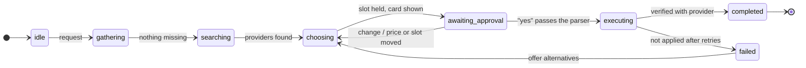
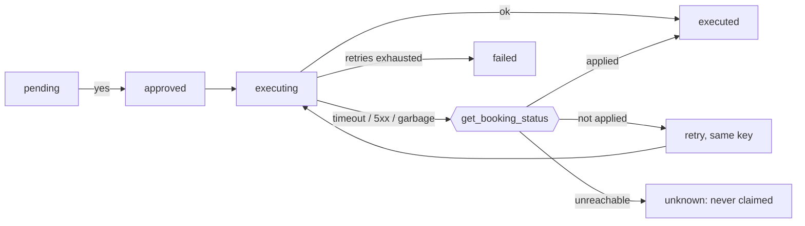

# Design note — Errand Agent (shipped as *Sorted*)

**Shape.** One agent loop (`agent.py`): the LLM (via LiteLLM) reads the conversation and picks tools. Code owns everything consequential: phase, approvals, idempotency, verification, memory gating, limits and the status lines users see. More agents wouldn't make enforcement or correctness easier. The 8 tools run against a seeded SQLite marketplace (`mock_env.py`, 367 providers) with the contract's odds and failure modes. Evals use an in-memory copy, so they stay reproducible.

**State model.** `WorkflowState` is a phase machine: `idle → gathering → searching → choosing → awaiting_approval → executing → completed | failed`. Only code changes the phase, on observed events, against an allow-list, and every transition is traced. `ErrandRequest` holds the slots and where each value came from (user / memory / event). Updates are merges, so "actually make it Thursday" changes only the date. Code computes `missing`, and the model asks only for those fields. State is saved to SQLite after every step.



**Approval enforcement.**
1. `request_approval` builds the proposal from the code's own records (the provider's hold, or the booking from `list_bookings`), never from model arguments. It mints an idempotency key and renders the exact text the user sees.
2. A deterministic parser decides approval from the next user message: a bare "yes" (English or Hindi) or `confirm <id>`, in reply to that proposal only. "But", numbers, negations or changes don't count.
3. `book` / `cancel` / `reschedule` run only if an approved proposal's material facts (provider, slot, price / booking, new slot) equal the current ones. Any difference voids the approval and the user is asked again.

Reviews, hostile users and a model that obeys injections can't produce an approval; evals check this.

**Idempotency and recovery.** The proposal row is a write-ahead ledger, marked `executing` before the provider call:



After a timeout, 5xx, exception or malformed reply, the executor asks `get_booking_status(idempotency_key)`:
- applied → success;
- not applied → bounded retry with the same key;
- unreachable → *unknown*, never success.

On startup, proposals left `executing` are resolved from that source of truth. Repeated "yes" or `book()` calls are answered from the ledger. "Verified" lines come only from executor results, and a claim guard rewrites unverified success claims.

**Memory.** Each fact has `{key, value, scope, source explicit|inferred, confirmed, status active|superseded|forgotten}`. An explicit write needs a quote from the user's own messages, so review text can't become memory. Inferred facts stay *unconfirmed* and excluded until the user confirms them. A correction supersedes the old fact. Forgetting tombstones the fact and scrubs its value from history.

**Context.** `ContextBuilder` fills a fixed token budget in priority order:
1. rules and tools;
2. state and notes;
3. the current turn (older tool results are elided);
4. gated memories (at most 15%);
5. history, as much as fits.

Only active, explicit-or-confirmed, relevant memories pass. Each build writes a manifest to the trace: tokens per section, each memory included or excluded *with a reason*, and history used. Tests replay it and fail if a forgotten or unconfirmed fact appears.

**Limits and observability.** Each run caps model calls, tool calls, wall-clock time and consecutive tool errors. Every exit ends with a code-written outcome (what happened, what changed, saved progress). The trace is JSONL per `run_id`, recording:
- context manifests;
- model calls (latency, tokens, cost);
- tool calls (arguments, sanitized results, latency);
- transitions, approvals, executions and recovery;
- memory decisions and limits.

**Trace excerpt — timeout after success** (`docs/traces/timeout_after_success.jsonl`, abridged):
```
approval        approved PFE3F6  user_text="yes"                  ← parser, not model, grants approval
state           awaiting_approval → executing
execution       executing  idempotency_key=idem-book-734c…         ← ledger written before the call
tool_call       book(H-0001, idem-book-734c…) → {"error":"timeout"}
recovery        timeout → query get_booking_status before deciding ← no blind retry
tool_call       get_booking_status(idem-book-734c…) → applied BK-1004
execution       executed  verified_by=get_booking_status note="timeout after success"
run_end         "✅ Verified: booking BK-1004 confirmed — QuickPipe, Mon 09 Nov, 10:00, ₹990"
```

**Trade-offs.** The approval parser is strict: "yeah go for it at that time" asks again. A false negative costs one turn; a false positive could book something unwanted. Token counts are estimated (chars/4) to keep evals deterministic; live runs also log the API's real counts.
